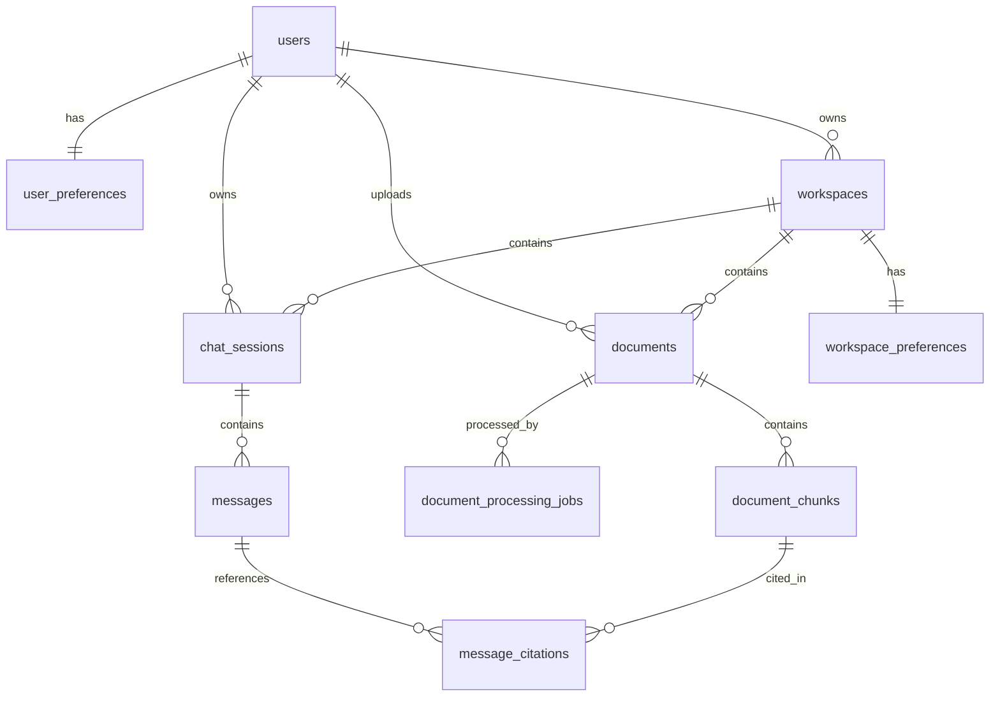

# Database Design

## Purpose

This document defines the database design for the Student Study Assistant platform.

The database design is derived from:

* Domain Model
* Functional Requirements
* Non-Functional Requirements
* Architectural Decisions

The objectives of the database design are:

* simplicity,
* maintainability,
* extensibility,
* data isolation,
* future scalability.

---

# Database Technologies

## Primary Database

**PostgreSQL**

### Rationale

* Production-grade relational database
* Excellent JSONB support
* Mature ecosystem
* Strong indexing capabilities
* Widely used in industry
* High portfolio and interview value

---

## Vector Database

**Qdrant**

### Rationale

* Open source
* Easy local deployment
* Excellent metadata filtering
* Good Python integration
* Supports future local-first deployments

---

# Database Principles

## Principle 1

Every resource belongs to exactly one user.

---

## Principle 2

Workspace is the primary organizational boundary.

---

## Principle 3

Derived data should be reproducible.

Examples:

* chunks
* embeddings
* citations

---

## Principle 4

Prefer explicit relationships over implicit relationships.

---

## Principle 5

Support future extensibility without major redesign.

---

# ID Strategy

All primary keys use:

```text
UUID
```

Example:

```text
550e8400-e29b-41d4-a716-446655440000
```

### Rationale

* Better security
* Future distributed support
* Industry standard
* Better portfolio value

---

# Audit Fields

Every table contains:

```text
id
created_at
updated_at
```

Soft-deletable tables additionally contain:

```text
deleted_at
```

---

# Soft Delete Strategy

## Soft Delete

* users
* workspaces
* documents
* chat_sessions

---

## Hard Delete

* user_preferences
* workspace_preferences
* document_chunks
* document_processing_jobs
* messages
* message_citations

---

# Tables

---

# users

Represents authenticated users.

## Columns

```text
id UUID PK

email VARCHAR UNIQUE NOT NULL
password_hash VARCHAR NULL
google_id VARCHAR NULL

full_name VARCHAR
profile_picture_url VARCHAR

is_active BOOLEAN DEFAULT TRUE
last_login_at TIMESTAMP

created_at TIMESTAMP
updated_at TIMESTAMP
deleted_at TIMESTAMP
```

---

# user_preferences

Stores global user preferences.

## Columns

```text
id UUID PK

user_id UUID FK UNIQUE

preferences JSONB

created_at TIMESTAMP
updated_at TIMESTAMP
```

---

## Example

```json
{
  "answer_style": "concise",
  "response_length": "short",
  "answer_format": "bullet"
}
```

---

# workspaces

Represents subject-based workspaces.

## Columns

```text
id UUID PK

user_id UUID FK

name VARCHAR NOT NULL
description TEXT

created_at TIMESTAMP
updated_at TIMESTAMP
deleted_at TIMESTAMP
```

---

## Constraints

```text
UNIQUE(user_id, name)
```

---

# workspace_preferences

Stores workspace-specific settings.

## Columns

```text
id UUID PK

workspace_id UUID FK UNIQUE

preferences JSONB

created_at TIMESTAMP
updated_at TIMESTAMP
```

---

## Example

```json
{
  "syllabus_mode": true,
  "preferred_depth": "exam"
}
```

---

# documents

Represents uploaded study materials.

## Columns

```text
id UUID PK

user_id UUID FK
workspace_id UUID FK

name VARCHAR
original_filename VARCHAR

storage_path TEXT
storage_provider VARCHAR DEFAULT 'local'

mime_type VARCHAR
file_size BIGINT

document_type VARCHAR
processing_status VARCHAR

page_count INTEGER
language VARCHAR

metadata JSONB

created_at TIMESTAMP
updated_at TIMESTAMP
deleted_at TIMESTAMP
```

---

## Document Types

```text
pdf
image
notes
syllabus
previous_paper
```

---

## Processing Status

```text
uploaded
processing
ready
failed
empty
```

---

# document_chunks

Represents searchable chunks.

## Columns

```text
id UUID PK

document_id UUID FK
workspace_id UUID FK

chunk_index INTEGER
page_number INTEGER

content TEXT
token_count INTEGER

metadata JSONB

created_at TIMESTAMP
updated_at TIMESTAMP
```

---

## Example Metadata

```json
{
  "start_char": 1200,
  "end_char": 1800,
  "ocr_confidence": 0.92
}
```

---

# document_processing_jobs

Represents asynchronous processing jobs.

## Columns

```text
id UUID PK

document_id UUID FK

status VARCHAR
stage VARCHAR

retry_count INTEGER DEFAULT 0

started_at TIMESTAMP
completed_at TIMESTAMP

error_message TEXT

created_at TIMESTAMP
updated_at TIMESTAMP
```

---

## Status

```text
pending
running
completed
failed
cancelled
```

---

## Stage

```text
text_extraction
ocr
chunking
embedding
indexing
```

---

# chat_sessions

Represents conversations.

## Columns

```text
id UUID PK

user_id UUID FK
workspace_id UUID FK

title VARCHAR

last_message_at TIMESTAMP

created_at TIMESTAMP
updated_at TIMESTAMP
deleted_at TIMESTAMP
```

---

# messages

Represents individual messages.

## Columns

```text
id UUID PK

chat_session_id UUID FK

role VARCHAR

content TEXT

token_count INTEGER

metadata JSONB

created_at TIMESTAMP
updated_at TIMESTAMP
```

---

## Role

```text
user
assistant
system
```

---

## Example Metadata

```json
{
  "retrieval_time_ms": 150,
  "used_generic_knowledge": false
}
```

---

# message_citations

Represents sources used in assistant responses.

## Columns

```text
id UUID PK

message_id UUID FK
document_chunk_id UUID FK
document_id UUID FK

snippet TEXT
page_number INTEGER

created_at TIMESTAMP
updated_at TIMESTAMP
```

---

# Relationships

```text
User
├── UserPreference (1:1)
├── Workspace (1:N)
├── Document (1:N)
└── ChatSession (1:N)

Workspace
├── WorkspacePreference (1:1)
├── Document (1:N)
└── ChatSession (1:N)

Document
├── DocumentChunk (1:N)
└── DocumentProcessingJob (1:N)

ChatSession
└── Message (1:N)

Message
└── MessageCitation (1:N)

DocumentChunk
└── MessageCitation (1:N)
```

---

# Entity Relationship Diagram



---

# Indexing Strategy

## users

```text
email UNIQUE INDEX
google_id INDEX
```

---

## workspaces

```text
(user_id, name) UNIQUE INDEX
```

---

## documents

```text
user_id INDEX
workspace_id INDEX
processing_status INDEX
document_type INDEX
```

---

## document_chunks

```text
document_id INDEX
workspace_id INDEX
(document_id, chunk_index) UNIQUE INDEX
```

---

## document_processing_jobs

```text
document_id INDEX
status INDEX
```

---

## chat_sessions

```text
user_id INDEX
workspace_id INDEX
last_message_at INDEX
```

---

## messages

```text
chat_session_id INDEX
created_at INDEX
```

---

## message_citations

```text
message_id INDEX
document_chunk_id INDEX
document_id INDEX
```

---

# Data Retention Strategy

## Delete Document

Delete:

* chunks
* embeddings
* citations
* processing jobs

Keep:

* audit information

---

## Delete Workspace

Delete:

* documents
* chats
* chunks
* embeddings
* citations

No orphaned data should remain.

---

# Migration Strategy

Use:

```text
SQLAlchemy + Alembic
```

Policy:

* Every schema change requires a migration.
* Migrations should be reversible whenever possible.

---

# Future Schema Extensions

Potential future tables:

```text
quizzes
flashcard_decks
study_plans
learning_goals
weak_topics
analytics_snapshots
summaries
```

These tables should primarily reference:

```text
workspace_id
user_id
```

---

# Design Rationale

## Why PostgreSQL?

* Strong relational support
* JSONB support
* Excellent ecosystem
* Portfolio value

---

## Why UUIDs?

* Better security
* Future scalability
* Industry practice

---

## Why JSONB?

Preferences and metadata change frequently and should not require migrations.

---

## Why Separate Processing Jobs?

Processing is:

* asynchronous,
* long-running,
* failure-prone.

Separate jobs improve:

* observability,
* debugging,
* retry handling.

---

# Status

Accepted.

This document should be revisited whenever:

* major features are introduced,
* deployment requirements change,
* scaling requirements change,
* storage requirements change.
