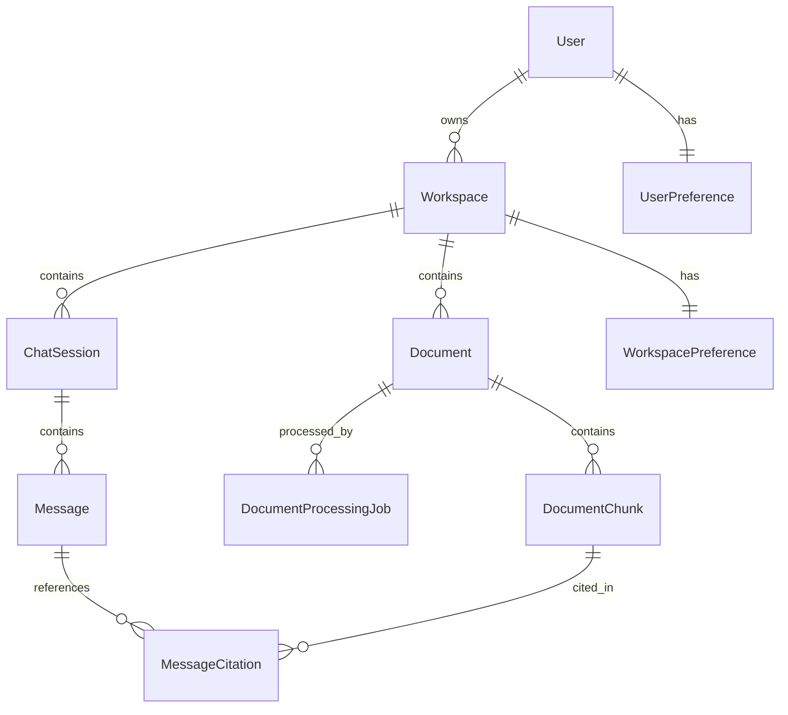

# Domain Model

## Purpose

This document defines the core business entities and relationships of the Student Study Assistant platform.

The domain model serves as the foundation for:

* Database Design
* API Design
* Service Boundaries
* Authorization Rules
* Future Feature Development

The model is intentionally focused on the MVP while providing extension points for future capabilities.

---

# Domain Principles

## Principle 1: Workspace is the Primary Organizational Boundary

A workspace represents:

* Subject
* Course
* Learning Area

Examples:

* Operating Systems
* Database Management Systems
* Computer Networks

All documents, chats, and preferences are scoped to a workspace.

---

## Principle 2: All User Data is Owned by Exactly One User

Every resource in the system belongs to exactly one user either directly or indirectly.

Examples:

* Workspace
* Documents
* Chat Sessions
* Preferences

This simplifies authorization and data isolation.

---

## Principle 3: Documents Belong to Exactly One Workspace

A document cannot exist outside of a workspace.

A document can only belong to one workspace.

---

## Principle 4: Search is Workspace Scoped

The MVP only supports retrieval within a single workspace.

Cross-workspace search is intentionally out of scope for the MVP.

---

## Principle 5: Long Running Tasks are Asynchronous

Document processing is performed asynchronously through background workers.

Processing status should always be visible to the user.

---

# Core Entities

The MVP consists of the following core entities:

* User
* UserPreference
* Workspace
* WorkspacePreference
* Document
* DocumentChunk
* DocumentProcessingJob
* ChatSession
* Message
* MessageCitation

---

# Entity Responsibilities

## User

Represents an authenticated user of the platform.

Responsibilities:

* Account ownership
* Authentication
* Authorization
* Workspace ownership
* Preference ownership

---

## UserPreference

Stores global user preferences.

Examples:

* Preferred answer style
* Preferred answer length
* Default AI settings

Responsibilities:

* Personalization
* User-specific configuration

---

## Workspace

Represents a subject-based learning environment.

Examples:

* Operating Systems
* Computer Networks
* DBMS

Responsibilities:

* Subject organization
* Search boundary
* Chat boundary
* Document organization
* Future learning artifacts

---

## WorkspacePreference

Stores preferences specific to a workspace.

Examples:

* Syllabus mode
* Preferred explanation depth
* Subject-specific settings

Responsibilities:

* Workspace customization
* Subject-specific configuration

---

## Document

Represents uploaded study materials.

Examples:

* PDFs
* Scanned notes
* Previous year papers
* Syllabus documents

Responsibilities:

* File metadata
* Processing status
* Source material management

---

## DocumentChunk

Represents a searchable unit of a document.

Responsibilities:

* Retrieval
* Search indexing
* Citation generation
* Metadata storage

DocumentChunk is treated as a first-class domain entity to support:

* debugging,
* retrieval evaluation,
* future analytics,
* source attribution.

---

## DocumentProcessingJob

Represents an asynchronous document processing task.

Responsibilities:

* OCR
* Chunking
* Embedding generation
* Indexing
* Retry management
* Failure tracking

---

## ChatSession

Represents a conversation inside a workspace.

Responsibilities:

* Conversation boundary
* Chat history
* Context management

---

## Message

Represents an individual message inside a conversation.

Examples:

* User questions
* Assistant responses

Responsibilities:

* Conversation history
* Context persistence

---

## MessageCitation

Represents the sources used to generate an assistant response.

Responsibilities:

* Source attribution
* Reproducible responses
* Citation support
* Future research workflows

---

# Entity Relationships

## User

A user:

* owns many workspaces
* owns many chat sessions
* has one user preference

---

## Workspace

A workspace:

* belongs to one user
* contains many documents
* contains many chat sessions
* has one workspace preference

---

## Document

A document:

* belongs to one workspace
* belongs to one user
* contains many chunks
* has many processing jobs

---

## ChatSession

A chat session:

* belongs to one user
* belongs to one workspace
* contains many messages

---

## Message

A message:

* belongs to one chat session
* may reference many citations

---

# Domain Model Diagram



---

# Aggregate Boundaries

## User Aggregate

```text
User
└── UserPreference
```

---

## Workspace Aggregate

```text
Workspace
├── WorkspacePreference
├── Documents
└── ChatSessions
```

---

## Document Aggregate

```text
Document
├── DocumentChunk
└── DocumentProcessingJob
```

---

## Chat Aggregate

```text
ChatSession
├── Messages
└── MessageCitations
```

---

# Ownership Hierarchy

```text
User
│
├── UserPreference
│
└── Workspace
      │
      ├── WorkspacePreference
      │
      ├── Document
      │      ├── DocumentChunk
      │      └── DocumentProcessingJob
      │
      └── ChatSession
              ├── Message
              └── MessageCitation
```

---

# Future Extension Points

The following entities are intentionally excluded from the MVP but should be attachable to the existing domain model without major redesign.

```text
Workspace
├── Quiz
├── FlashcardDeck
├── StudyPlan
├── LearningAnalytics
├── Summary
├── LearningGoal
└── WeakTopic
```

These entities should primarily attach to the Workspace aggregate.

---

# Design Rationale

## Why is Workspace the Primary Boundary?

Students naturally organize materials subject-wise.

Examples:

* Operating Systems
* DBMS
* Computer Networks

This makes navigation and retrieval simpler.

---

## Why are Chunks First-Class Entities?

Because they support:

* debugging
* retrieval evaluation
* analytics
* source attribution
* future retrieval improvements

---

## Why are Citations Stored?

To support:

* reproducible conversations
* source references
* future research features
* better trust and explainability

---

## Why are Processing Jobs Separate?

Document processing is:

* asynchronous
* long running
* failure prone

Separating processing concerns improves:

* reliability
* observability
* recoverability

---

# Domain Boundaries

## Identity Context

* User
* UserPreference

---

## Workspace Context

* Workspace
* WorkspacePreference

---

## Document Context

* Document
* DocumentChunk
* DocumentProcessingJob

---

## Conversation Context

* ChatSession
* Message
* MessageCitation

---

# Future Evolution

The domain model should support future additions without requiring redesign of:

* User
* Workspace
* Document
* ChatSession

Examples:

* Collaboration
* Cross-workspace search
* Quizzes
* Analytics
* Local-first deployments
* Personalized tutoring
* Adaptive learning

---

# Status

Accepted.

This document should be reviewed whenever:

* major product requirements change,
* new user groups are introduced,
* significant architectural decisions change,
* future learning features are introduced.
