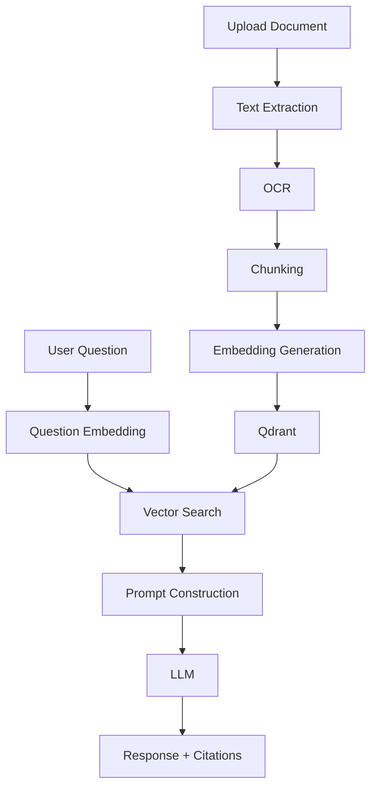
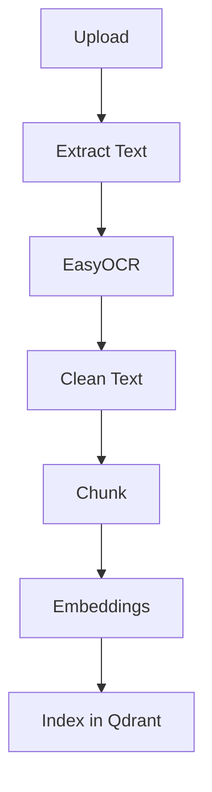
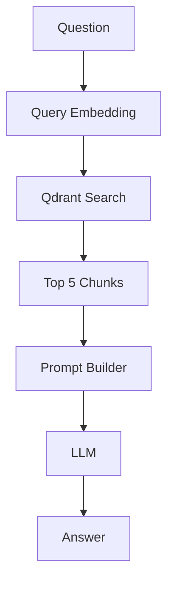

# RAG Architecture

## Purpose

This document defines the Retrieval-Augmented Generation (RAG) architecture of the Student Study Assistant platform.

The purpose of the RAG system is to:

* provide grounded answers,
* search user documents efficiently,
* reduce hallucinations,
* provide source attribution,
* support future AI capabilities.

The RAG architecture is optimized for:

* educational use cases,
* portfolio value,
* maintainability,
* future extensibility.

---

# RAG Design Principles

## Principle 1

Answers should be grounded in user-provided materials whenever possible.

---

## Principle 2

The system should provide citations and source attribution.

---

## Principle 3

Document processing should be asynchronous.

---

## Principle 4

Retrieval quality is more important than retrieval speed for MVP.

---

## Principle 5

The architecture should support future improvements without major redesign.

Examples:

* Hybrid Search
* Re-ranking
* Cross-workspace Search
* Local Models
* Personalized Retrieval

---

# High-Level RAG Architecture

```text
Document Upload
        ↓
Document Processing Pipeline
        ↓
Chunking
        ↓
Embedding Generation
        ↓
Vector Storage (Qdrant)
        ↓
Retrieval
        ↓
Prompt Construction
        ↓
LLM
        ↓
Response + Citations
```

---

# End-to-End Architecture



---

# Document Ingestion Pipeline

## Step 1

Upload document.

---

## Step 2

Determine document type.

Examples:

* PDF
* Image
* Notes
* Previous Papers

---

## Step 3

Attempt direct text extraction.

---

## Step 4

If extraction fails:

```text
EasyOCR
```

---

## Step 5

Clean extracted text.

Examples:

* remove empty pages
* normalize whitespace
* remove duplicate text

---

## Step 6

Chunk text.

---

## Step 7

Generate embeddings.

---

## Step 8

Store vectors and metadata.

---

# Processing Pipeline



---

# Chunking Strategy

## Technique

Fixed-size chunking.

---

## Chunk Size

```text
800 tokens
```

---

## Overlap

```text
100 tokens
```

---

## Rationale

* Simple implementation
* Reliable performance
* Good retrieval quality
* Suitable for educational materials

---

# Example

```text
Chunk 1
Words 1-800

Chunk 2
Words 701-1500
```

---

# Metadata Design

Each chunk stores:

```text
user_id
workspace_id
document_id
chunk_id
chunk_index
page_number
document_type
created_at
```

Optional metadata:

```text
ocr_confidence
language
section_title
```

---

# Embedding Strategy

## Model

```text
BAAI/bge-small-en-v1.5
```

---

## Rationale

* Excellent retrieval quality
* Lightweight
* Local execution
* No API costs
* Suitable for portfolio projects

---

# Vector Storage

## Database

```text
Qdrant
```

---

## Collection Strategy

Single collection:

```text
document_chunks
```

---

## Filtering Strategy

Metadata filters:

```text
user_id
workspace_id
document_id
```

---

# Retrieval Pipeline

## Step 1

Receive user question.

---

## Step 2

Generate query embedding.

---

## Step 3

Search Qdrant.

---

## Step 4

Retrieve:

```text
top_k = 5
```

chunks.

---

## Step 5

Construct context.

---

## Step 6

Send to LLM.

---

# Retrieval Flow



---

# Retrieval Scope

MVP:

```text
Single Workspace Search
```

Future:

```text
Cross-Workspace Search
```

---

# Re-ranking Strategy

MVP:

```text
No Re-ranking
```

Future:

```text
Cross Encoder Re-ranking
```

Examples:

* BGE Reranker
* Cohere Reranker

---

# Hybrid Search

MVP:

```text
Pure Vector Search
```

Future:

```text
Keyword Search
+
Vector Search
```

---

# Query Rewriting

MVP:

```text
Disabled
```

Future:

* query expansion
* question rewriting
* conversational query generation

---

# Prompt Construction

Prompt structure:

```text
System Prompt
+
Conversation Summary
+
Recent Messages
+
Retrieved Context
+
Current User Question
```

---

# Conversation Memory

## Strategy

```text
Summary
+
Last 9 Messages
```

---

## Rationale

* Lower token cost
* Better scalability
* Preserves context

---

# Context Budget

Maximum retrieved context:

```text
4000 tokens
```

---

# Citation Strategy

Every answer should include:

```text
Document Name
Page Number
Snippet
```

Citations are stored separately.

---

# Example

```text
Operating Systems Notes.pdf
Page 32
```

---

# Hallucination Mitigation

## Rule 1

Prefer retrieved information.

---

## Rule 2

If confidence is low:

* inform the user,
* provide a warning.

---

## Rule 3

If generic knowledge is used:

Clearly indicate:

```text
This answer was generated using general knowledge and may not exist in your uploaded materials.
```

---

# Empty Retrieval Strategy

If no results are found:

```text
No relevant information was found in your uploaded materials.
```

Offer:

* ask another question,
* use general knowledge.

---

# Evaluation Strategy

## Metrics

### Retrieval Metrics

* Recall@K
* Precision@K

---

### Generation Metrics

* Groundedness
* Citation Accuracy
* Hallucination Rate

---

### User Metrics

* Response Latency
* User Satisfaction
* Successful Answer Rate

---

# Observability

Track:

```text
retrieval_time_ms
generation_time_ms
token_usage
chunks_retrieved
citations_generated
```

---

# Failure Handling

## OCR Failure

Mark document:

```text
failed
```

---

## Embedding Failure

Retry using background jobs.

---

## Qdrant Failure

Retry indexing.

---

## Partial Failure

Keep document record.

Allow retry.

---

# Security Considerations

## Isolation

All retrieval queries must filter by:

```text
user_id
workspace_id
```

---

## Prompt Injection Protection

Retrieved documents are treated as untrusted input.

Never allow documents to override:

* system prompts
* application instructions.

---

## Data Privacy

Users can only retrieve:

* their own documents,
* their own embeddings.

---

# Future Improvements

* Hybrid Search
* Re-ranking
* Cross-workspace Search
* Personalized Retrieval
* Adaptive Context Selection
* Multi-Query Retrieval
* Knowledge Graph Integration
* Local LLM Support
* Local Embedding Models
* Retrieval Evaluation Dashboard

---

# Design Rationale

This architecture intentionally prioritizes:

* simplicity,
* educational use cases,
* maintainability,
* good retrieval quality,
* reasonable implementation complexity.

The system avoids overengineering while leaving clear extension points for future capabilities.

---

# Status

Accepted.

This document should be reviewed whenever:

* retrieval strategy changes,
* embedding models change,
* new AI capabilities are introduced,
* search requirements change.
