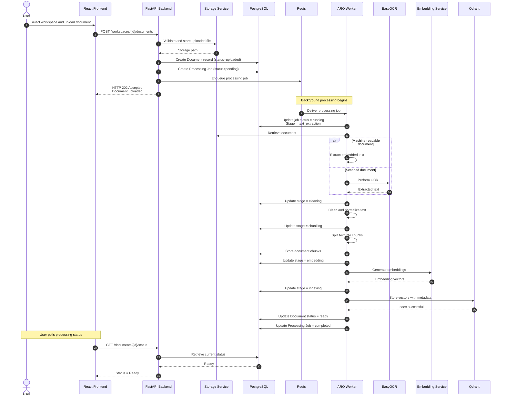
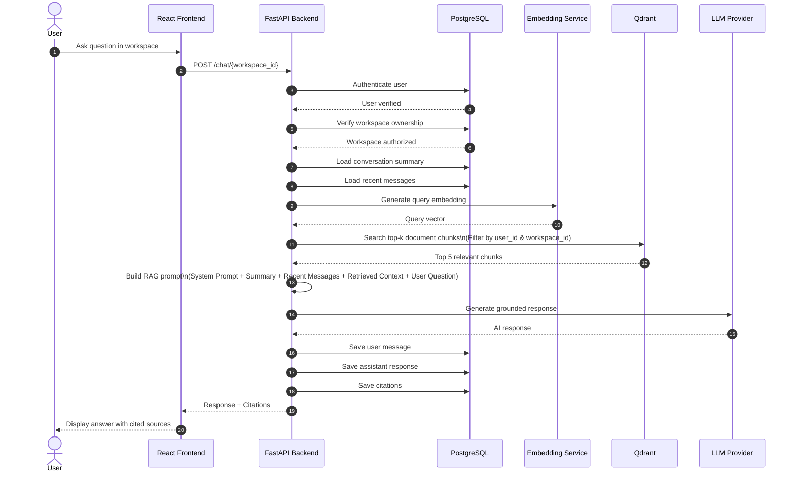
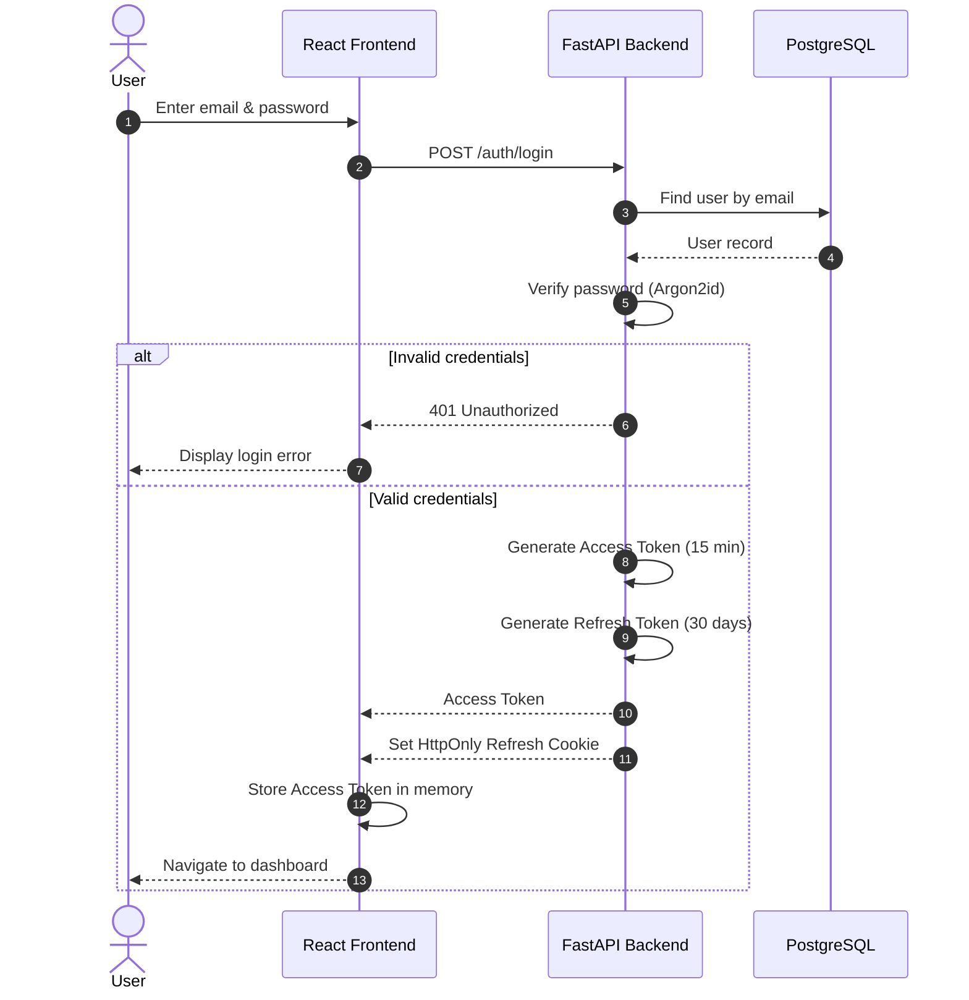
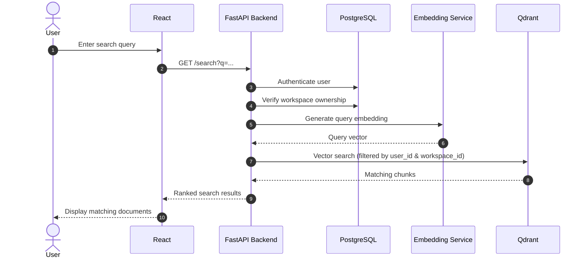
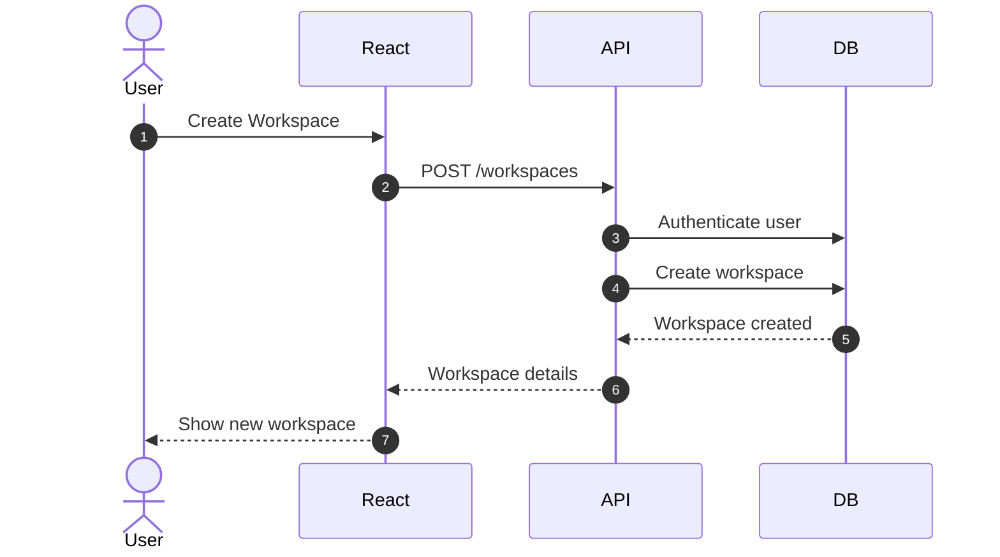
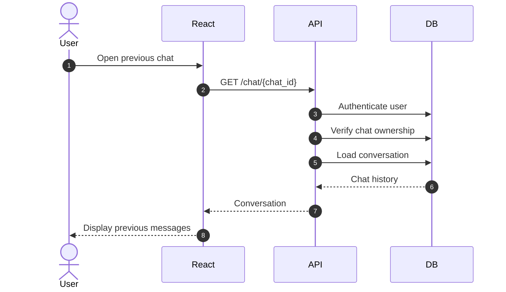
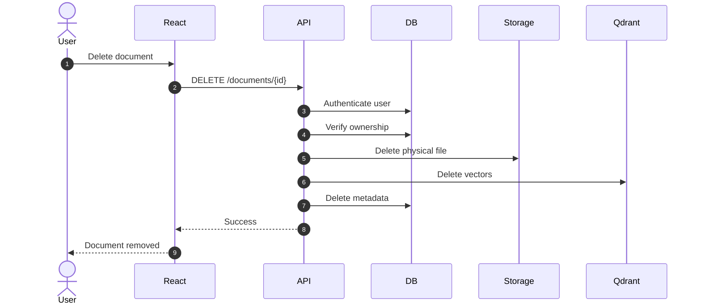
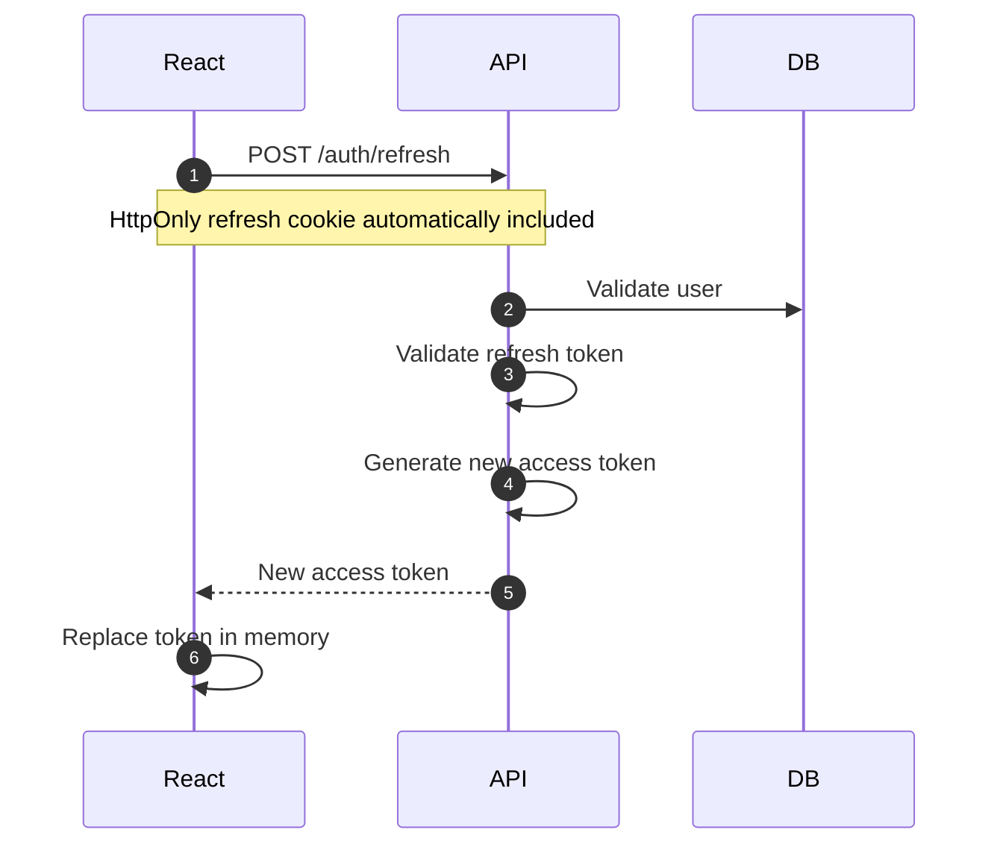

# Sequence Diagrams

## Purpose

This document defines the sequence diagrams for the Student Study Assistant platform.

The sequence diagrams describe how system components collaborate to execute the platform's primary business workflows.

They complement the architecture documentation by illustrating the runtime interactions between the frontend, backend services, infrastructure components, and external providers.

The objectives of this document are to:

* visualize request and response flows,
* clarify component responsibilities,
* support implementation planning,
* identify integration points,
* document asynchronous workflows,
* assist testing and debugging.

---

# Scope

This document covers the primary runtime workflows of the MVP, including:

* Authentication
* Document Upload and Processing
* Chat with Documents (RAG)
* Semantic Search
* Workspace Management
* Chat History
* Document Deletion
* Token Refresh

These diagrams focus on interactions between components rather than internal implementation details.

---

# Participants

The sequence diagrams use the following participants:

| Participant       | Description                                |
| ----------------- | ------------------------------------------ |
| User              | Student interacting with the application   |
| React Frontend    | Web client built with React and TypeScript |
| FastAPI Backend   | REST API and application entry point       |
| PostgreSQL        | Primary relational database                |
| Storage Service   | File storage abstraction layer             |
| Redis             | Background job queue                       |
| ARQ Worker        | Background processing worker               |
| OCR Engine        | Extracts text from scanned documents       |
| Embedding Service | Generates vector embeddings                |
| Qdrant            | Vector database                            |
| LLM Provider      | Generates AI responses                     |

---

## SD-001: Document Upload & Processing

### Purpose

This sequence diagram illustrates the complete lifecycle of a document from upload through background processing until it becomes searchable.

The workflow demonstrates the interaction between the frontend, backend, storage layer, background worker, OCR pipeline, embedding generation, and vector indexing.



### Notes

* The upload endpoint returns immediately with **HTTP 202 Accepted** while processing continues asynchronously.
* The uploaded file is persisted before any background processing begins.
* OCR is executed only when machine-readable text cannot be extracted.
* Processing stages are updated throughout the pipeline to provide visibility to users.
* The document becomes searchable only after successful vector indexing.
* Users retrieve processing progress through the status endpoint by polling.

---

## SD-002: Chat with Documents (RAG)

### Purpose

This sequence diagram illustrates how the platform answers a user's question using Retrieval-Augmented Generation (RAG).

The workflow retrieves relevant document chunks from the selected workspace, constructs a grounded prompt, generates a response using the LLM, and returns citations to the user.



### Notes

* Every request is authenticated before retrieval begins.
* Workspace ownership is validated before any document search.
* Query embeddings are generated using the same embedding model used during document indexing.
* Vector search is limited to the user's current workspace through metadata filtering.
* The retrieved chunks are incorporated into the prompt alongside the conversation summary and recent messages.
* The assistant response and citation metadata are stored for future conversation history.
* The frontend displays both the generated answer and its supporting citations.

---

### Failure Scenarios

#### No Relevant Documents Found

```text
User Question
      │
      ▼
Vector Search
      │
      ▼
No Matching Chunks
      │
      ▼
LLM receives no document context
      │
      ▼
Response:
"No relevant information was found in your uploaded materials."
```

The user may optionally choose to receive an answer based on general knowledge, clearly labelled as such.

---

#### LLM Provider Unavailable

```text
Prompt Construction
        │
        ▼
LLM Request
        │
        ▼
Provider Error
        │
        ▼
Return Friendly Error Message
```

The conversation remains intact, allowing the user to retry later.

---

#### Unauthorized Workspace Access

```text
Workspace Validation
        │
        ▼
Ownership Check Failed
        │
        ▼
Return HTTP 403 Forbidden
```

No retrieval request is sent to Qdrant.

---

### Design Decisions Demonstrated

This sequence diagram illustrates several architectural decisions:

* Ownership-based authorization before retrieval.
* Metadata-filtered vector search (`user_id` and `workspace_id`).
* Conversation memory using a summary plus recent messages.
* Prompt construction from multiple context sources.
* Grounded responses with citations.
* Persistent storage of conversations and citations.
* Clear handling of empty retrieval and provider failures.

---

## SD-003: User Authentication

### Purpose

This sequence diagram illustrates the authentication flow for a user logging into the Student Study Assistant platform.

The workflow demonstrates credential validation, JWT generation, secure token storage, and establishment of an authenticated session.



### Notes

* Password verification uses Argon2id.
* Access tokens are returned in the response body.
* Refresh tokens are stored as HttpOnly Secure cookies.
* The frontend stores the access token only in application memory.
* The backend remains stateless and does not maintain server-side sessions.
* Authentication succeeds only after credentials are successfully verified.

---

### Authentication State

After successful login:

```text
React Memory
--------------
Access Token

Browser Cookie
--------------
Refresh Token (HttpOnly)

Backend
--------------
No Session Storage
```

---

### Failure Scenarios

#### Invalid Credentials

```text
Login Request
      │
      ▼
Password Verification
      │
      ▼
Verification Failed
      │
      ▼
HTTP 401 Unauthorized
```

The frontend displays an authentication error without revealing whether the email or password was incorrect.

---

#### Disabled Account

```text
Credentials Valid
      │
      ▼
Account Status Check
      │
      ▼
Disabled
      │
      ▼
HTTP 403 Forbidden
```

Authentication is denied even though the credentials are correct.

---

#### Database Unavailable

```text
Login Request
      │
      ▼
Database Lookup
      │
      ▼
Database Failure
      │
      ▼
HTTP 500 Internal Server Error
```

The frontend displays a generic error message and allows the user to retry.

---

### Design Decisions Demonstrated

This sequence diagram illustrates the following architectural decisions:

* Email and password authentication.
* Argon2id password verification.
* Stateless JWT authentication.
* Access token stored in React memory.
* Refresh token stored in an HttpOnly Secure cookie.
* No server-side session storage.
* Clear separation between authentication and authorization.

```
```

---

## SD-004: Semantic Search

### Purpose

This sequence diagram illustrates how a user searches across documents within a workspace without generating an AI response.



### Notes

* No LLM call is performed.
* Results come directly from semantic retrieval.
* Workspace filtering guarantees user isolation.

---

## SD-005: Workspace Management

### Purpose

This diagram illustrates workspace creation.



### Notes

* Workspace ownership is assigned during creation.
* Every workspace belongs to exactly one user.

---

## SD-006: Chat History

### Purpose

Illustrates continuing an existing conversation.



### Notes

* Conversation ownership is verified before retrieval.
* Summary and recent messages are loaded for future prompts.

---

## SD-007: Document Deletion

### Purpose

Illustrates permanent document removal and cleanup.



### Notes

* Storage cleanup occurs before metadata removal.
* Vector data is deleted together with the document.
* No orphaned resources remain.

---

## SD-008: Token Refresh

### Purpose

Illustrates automatic access-token renewal.



### Notes

* No password is required.
* Refresh token remains inside an HttpOnly cookie.
* Only the access token is replaced.
* Users remain logged in without interruption.

---

# Design Principles

The sequence diagrams follow these principles:

1. Show business interactions rather than implementation details.
2. Include asynchronous operations where applicable.
3. Clearly distinguish synchronous and background processing.
4. Reflect the accepted modular monolith architecture.
5. Remain implementation-agnostic where possible.
6. Stay consistent with the API, database, background job, storage, authentication, deployment, and RAG architecture documents.

---

# Relationship to Other Documents

This document should be read alongside:

* Architecture Overview
* Domain Model
* API Design
* Database Design
* Storage Design
* Background Job Architecture
* Authentication Design
* RAG Architecture
* Deployment Architecture

Together, these documents describe both the static architecture and the runtime behavior of the system.

---

# Status

Accepted.

This document should be updated whenever:

* a major workflow changes,
* new infrastructure components are introduced,
* new external integrations are added,
* asynchronous processing behavior changes,
* API contracts change in a way that affects runtime interactions.
