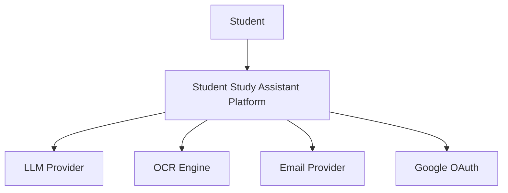
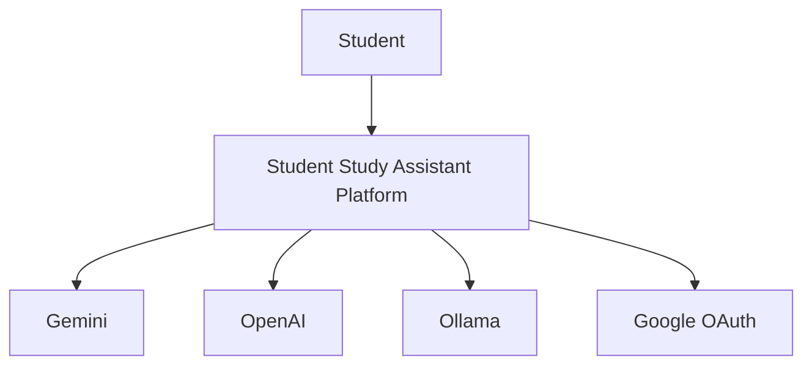

# System Context Diagram

## Purpose

This document defines the external actors and systems that interact with the Student Study Assistant platform.

The objective of this diagram is to define:

- system boundaries,
- external dependencies,
- primary users,
- integration points.

---

# System Boundary

The Student Study Assistant platform is an AI-powered learning workspace that allows students to:

- organize study materials,
- search information,
- chat with documents,
- receive syllabus-aware assistance.

---

# Primary Actor

## Student

University students using the platform to upload documents, search information, and interact with AI.

---

# External Systems

## LLM Provider

Responsible for generating responses.

Examples:

- Gemini
- OpenAI
- Ollama (future)

---

## OCR Engine

Responsible for extracting text from scanned documents.

Current:

- EasyOCR

Future:

- Cloud OCR providers

---

## Email Provider

Responsible for:

- account verification
- password recovery
- notifications

Examples:

- Resend
- SendGrid
- SMTP

---

# System Context Diagram

---

# Future Provider Ecosystem

---

# Architectural Implications

- The platform depends on external AI providers.
- AI providers should be abstracted behind provider interfaces.
- OCR should remain replaceable.
- Authentication providers should remain replaceable.

---

# System Boundary

Everything inside the Student Study Assistant platform is owned and managed by the application, including:

- authentication logic
- document processing
- retrieval pipeline
- vector search
- chat orchestration
- data persistence

Everything outside the boundary is treated as an external dependency.

---

# Context Assumptions

- Users have internet connectivity when cloud providers are used.
- OCR providers may be replaced in the future.
- AI providers may change without affecting business logic.
- Authentication providers should remain replaceable.
